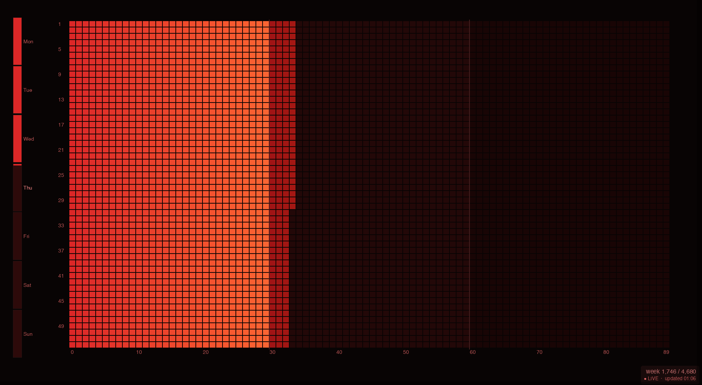

# Life Calendar Wallpaper

A live desktop wallpaper that renders a **life calendar** — a grid where each cell represents one week of your life. Elapsed weeks are shaded; future weeks are dim. Thirty-year periods use distinct colours so major life phases are immediately visible. If you liked this, [buy me a coffee!](https://ko-fi.com/knguyenanhoa)



## Requirements

- Python 3.9+
- macOS 12+ (primary) or Linux (X11/Wayland)
- `Pillow` (installed automatically by `install.sh`)
- `lunardate` (installed automatically; adds the lunar date + moon phase to the weather panel — the panel still renders without it)
- `rumps` (optional, for a native macOS menu-bar icon)

## Quick Start

```bash
# 1. Clone / download the repo, then:
bash install.sh
```

`install.sh` will:
1. Create a `.venv` virtual environment and install `Pillow` (and `rumps` on macOS).
2. Write a `~/Library/LaunchAgents/com.lifecal.wallpaper.plist` so the app auto-starts on login.
3. Launch the app immediately.

On first run the Settings window opens automatically (no birthday is set yet).

## Manual Usage

```bash
# Activate the venv
source .venv/bin/activate

# Start normally (opens Settings if no birthday is configured)
python main.py

# Open Settings window on startup
python main.py --settings

# Render once and exit (good for testing)
python main.py --render-once

# Set birthday and theme from the command line
python main.py --birthday 1990-05-15 --theme dark
```

## Settings Window

Open it any time by:
- Clicking **Open Settings** in the menu-bar icon (if `rumps` is installed), or
- Double-clicking the Dock icon (hidden window), or
- Running `python main.py --settings`

| Field | Description |
|---|---|
| Birthday | Your date of birth (`YYYY-MM-DD`). Drives the elapsed-week calculation. |
| Theme | Visual theme (see [Themes](#themes)). |
| Show year labels | Toggle the year axis labels. |
| Show week labels | Toggle the week axis labels. |
| Show weather | Toggle the weather panel in the bottom zone. |
| Show space weather | Toggle an extra column (left of the weather panel) with the geomagnetic Kp index + aurora outlook, a solar-activity level (NOAA R-scale), the solar-cycle phase, and visible planets / conjunctions. Kp and activity come from NOAA SWPC; cycle and planets are computed locally. |
| Location | Place name for the weather (e.g. `Ho Chi Minh City`). Blank falls back to the default location. |
| Temperature unit | `°C` or `°F`. |
| Rain chance | Show the hourly rain chance as a mini pie chart or as a percentage. |

Changes are applied immediately when you click **Apply**.

## Weather Quick View

The menu-bar icon also has an **Open Weather** item. It opens a small window
that previews *only* the weather widget, filling the preview. Type a location
and the forecast re-renders for that place — a quick way to check the weather
somewhere without changing your wallpaper. You can also toggle the temperature
unit and rain-chance display here. Nothing in this window is saved; it's a
throwaway lookup that starts from your current weather settings.

## Themes

Themes live as JSON files in the `themes/` directory. Each `.json` file is one
theme, loaded on startup; its `name` field is what appears in the theme picker.
Every theme defines distinct colours per 30-year period for both elapsed and
future cells.

Built-in themes include:

| Theme | Notes |
|---|---|
| `dark` / `light` / `monochrome` | The original three solid palettes. |
| `gradient_amber` / `_crimson` / `_emerald` / `_sapphire` / `_violet` | Each period ramps between two colours. |
| `season_spring` / `_summer` / `_autumn` / `_winter` | Seasonal palettes, selectable on their own. |
| `season_dynamic (auto)` | A dynamic pseudo-theme (no backing file) that resolves at render time to the season palette matching today's date. |
| `minecraft` | A themed palette. |

To add a custom theme, drop a new `.json` file in `themes/` following the shape
of an existing one. The keys mirror the `Theme` dataclass in `config.py`;
colours are `[r, g, b]` arrays and any omitted key falls back to its default.

## Configuration File

Stored at `~/.lifecal/config.json`. You can edit it directly; the app picks up changes within ~2 seconds.

```json
{
  "birthday": "1990-05-15",
  "theme": "gradient_crimson",
  "canvas_width": 0,
  "canvas_height": 0,
  "padding_top": 80,
  "padding_bottom": 80,
  "padding_left": 80,
  "padding_right": 80,
  "cell_gap": 2,
  "show_year_labels": true,
  "show_week_labels": true,
  "show_weather": true,
  "weather_fahrenheit": false,
  "weather_location": "",
  "weather_latitude": null,
  "weather_longitude": null,
  "weather_rain_as_pie": true,
  "show_space_weather": false
}
```

Set `canvas_width` / `canvas_height` to `0` to auto-detect the display resolution.

## Grid Layout

Defined by constants at the top of `config.py`:

```python
YEARS          = 90   # columns (one per year)
WEEKS_PER_YEAR = 52   # rows (one per week)
PERIOD_YEARS   = 30   # colour-band width in years
```

Change these to reshape the grid without touching anything else.

## Logs (macOS)

```
~/.lifecal/logs/stdout.log
~/.lifecal/logs/stderr.log
```

## Uninstall

```bash
bash uninstall.sh
# optionally:
rm -rf ~/.lifecal
```

## Project Structure

```
x-lifecal-wallpaper/
├── main.py          # entry point, update loop, tray icon
├── config.py        # settings, themes, constants, data dir
├── renderer.py      # Pillow-based grid + weather renderer
├── wallpaper.py     # OS wallpaper setter (macOS + Linux)
├── weather.py       # weather fetch + disk cache (stdlib only)
├── settings_ui.py   # tkinter settings window
├── themes/          # one JSON file per theme
├── tests/           # pytest suite for the pure logic
├── install.sh       # one-step install + LaunchAgent setup
├── uninstall.sh     # remove LaunchAgent
└── requirements.txt # Pillow, lunardate
```

## Development

Run the test suite from the project root (inside the virtualenv):

```bash
source .venv/bin/activate
pip install pytest        # once
python -m pytest
```
